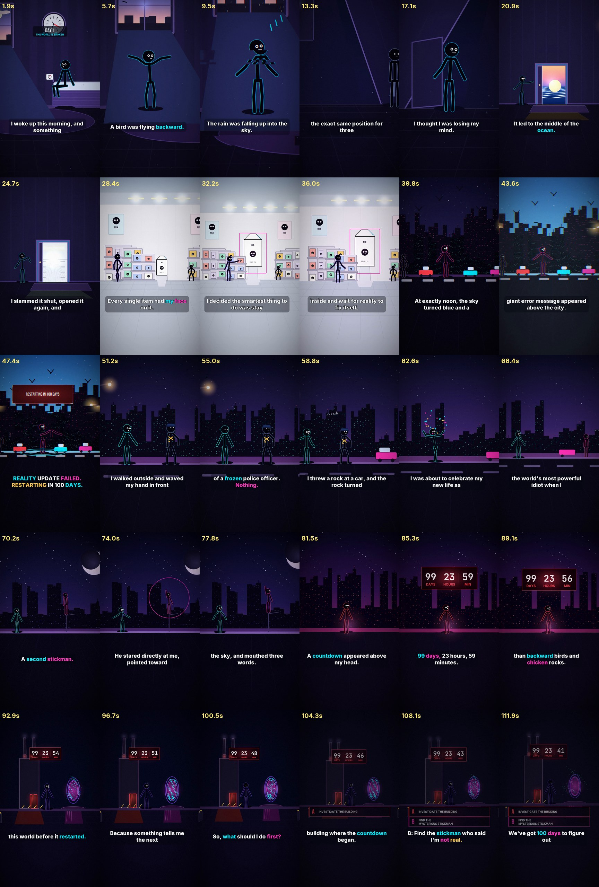

# 100 Days Trapped in a Glitched World — Day 1: “THE WORLD IS BROKEN”

A finished, publish-ready vertical short (1080×1920, 30 fps) cut to the supplied
voiceover, plus the complete procedural production pipeline that made it.



| | |
|---|---|
| **Final video** | [`final/glitch-world-day-01.mp4`](final/glitch-world-day-01.mp4) |
| **Subtitles (editable)** | [`final/glitch-world-day-01.srt`](final/glitch-world-day-01.srt) |
| **Source voiceover (untouched)** | [`audio/original-voiceover.mp3`](audio/original-voiceover.mp3) |
| **Storyboard / contact sheet** | [`previews/storyboard.jpg`](previews/storyboard.jpg) · [`previews/contact-sheet.jpg`](previews/contact-sheet.jpg) |
| **QA report** | [`reports/quality-check.md`](reports/quality-check.md) |
| **Runtime** | 1:53.79 (measured from the recording) |

---

## 1. The source recording

| | |
|---|---|
| Drive file | `ElevenLabs_2026-10-26T13_08_54_Professor Bill_pvc_sp100_s54_sb35_v4.mp3` |
| Drive file id | `1ltLYzoxuxMiWrdWMRhTYQSt1hYuRu0Zw` |
| Delivered as | MP3, 128 kb/s, mono, 44.1 kHz, 1 837 567 bytes (+ 16-bit WAV copy) |
| Measured duration | **113.789 s** (1:53.79) |
| Local copy | `audio/original-voiceover.mp3` — byte-identical to the Drive download; `audio/original-voiceover.wav` is a 44.1 kHz mono 16-bit decode for editing |
| Speech structure | 42 speech units, 97.97 s of speech, 39 pauses ≥ 200 ms |

The recording is the clock for the whole edit. `project/analyze_audio.py` decodes
it to 48 kHz, runs an energy gate over 10 ms frames (adaptive threshold from the
noise floor and the loud tail of the signal), closes gaps under 180 ms and drops
blips under 120 ms. That yields the speech segments and pauses in
`scripts/audio-analysis.json`, and every shot boundary in the film snaps to one
of those silent spots.

**The recording is never altered.** It is decoded, mixed underneath the sound
design, and encoded to AAC at 48 kHz / 192 kb/s. No time-stretching, no rewriting,
no re-recording.

## 2. What is in this directory

```text
videos/glitch-world-day-01/
├── README.md                      this file
├── final/
│   ├── glitch-world-day-01.mp4     1080x1920, 30 fps, H.264 + AAC 48 kHz
│   └── glitch-world-day-01.srt     editable captions (50 cues)
├── audio/
│   ├── original-voiceover.mp3      the supplied recording, unmodified
│   └── original-voiceover.wav      44.1 kHz mono 16-bit decode of the above
├── scripts/
│   ├── transcript.txt              the words that were actually spoken
│   ├── audio-analysis.json         duration, speech segments, pauses (measured)
│   ├── sentences.json              34 sentences with start/end times
│   ├── subtitles.json              caption cues + accent-word markup
│   └── scene-timeline.json         the edit: 11 shots, camera keys, overlays
├── project/                        the pipeline (see §4)
│   ├── engine.py                   camera, pen, glow, glitch FX, encoder I/O
│   ├── rig.py                      the protagonist rig + pose library
│   ├── world.py                    reusable sets, props, UI panels, countdown
│   ├── scenes.py                   all nine scenes, drawn procedurally
│   ├── timeline.py                 loads the edit, interpolates cameras
│   ├── subs.py                     burned-in captions + in-world type
│   ├── render.py                   frame pipeline + CLI
│   ├── analyze_audio.py            measures the recording
│   ├── build_subs.py               aligns the transcript, writes SRT + cues
│   ├── build_timeline.py           writes scene-timeline.json
│   ├── build_audio.py              synthesises the sound design + final mix
│   ├── make_previews.py            storyboard / contact sheet / character sheet
│   ├── remux_audio.py              swap the mix in without re-encoding the picture
│   └── qa_check.py                 automated quality gate -> reports/
├── assets/
│   ├── fonts/                      Inter, Bebas Neue, JetBrains Mono (+ licences)
│   └── sound-effects/              reference stems exported by build_audio.py
├── previews/
│   ├── storyboard.jpg              one frame per shot, pulled from the MP4
│   ├── contact-sheet.jpg           30 frames across the film
│   ├── character-sheet.jpg         the rig in its twelve key poses
│   └── waveform.png                the recording, with speech/pause marks
└── reports/
    └── quality-check.md            every automated check and its result
```

## 3. Art direction

* **Character — “NIX”.** A black stick figure with a round head, real shoulders,
  five segments per limb pair and a face built from a handful of strokes. Poses are
  plain dictionaries of joint angles, so any two poses blend into unlimited
  in-betweens (`rig.blend`, `rig.seq`). This is the piece that is reused in every
  future episode.
* **World.** Deep blue/violet shadow, electric cyan and magenta glitch, warning red
  for the countdown and the “A” path. Every set is drawn from vector primitives by
  code, so it can be re-shot from a different angle in a later episode.
* **Lighting.** Warm practicals (bedroom lamp, street lamp, laundry-room strips)
  against cold glitch light, plus additive glow sprites for every light source.
* **Motion.** Camera dolly/parallax per shot, walk cycles, pose-to-pose acting,
  procedural particles (rain, dust, pixel shards), object transformation
  (rock → chicken), UI animation (countdown, panels) and a per-shot shake value.
* **Typography.** Dialogue captions in Inter ExtraBold; in-world system panels in
  Bebas Neue; the countdown in JetBrains Mono. Captions are never confused with
  in-world type.

## 4. Reproducing the render

Requires **Python 3.10+** and three packages:

```bash
pip install pillow numpy imageio-ffmpeg        # imageio-ffmpeg ships the ffmpeg binary
pip install pyloudnorm                          # optional: -14 LUFS loudness target
```

ffmpeg is used from the `imageio-ffmpeg` wheel, so no system install is needed.
Everything else is in the standard library.

```bash
cd videos/glitch-world-day-01

python3 project/analyze_audio.py      # 1. measure the recording   -> scripts/audio-analysis.json
python3 project/build_subs.py         # 2. align the words         -> scripts/sentences.json + subtitles.json + SRT
python3 project/build_timeline.py     # 3. build the edit          -> scripts/scene-timeline.json
python3 project/build_audio.py        # 4. sound design + mix      -> .work/mix.wav
python3 project/render.py --all --audio .work/mix.wav --crf 25 --preset slow
python3 project/make_previews.py      # 5. storyboard + contact sheet from the MP4
python3 project/qa_check.py           # 6. quality gate            -> reports/quality-check.md

# iterating on sound only (no re-render, video stream is copied):
python3 project/build_audio.py && python3 project/remux_audio.py
```

Quick loops while working:

```bash
python3 project/render.py --still 12.5 44.6 99.5        # preview single frames
python3 project/render.py --range 70 76 --out /tmp/x.mp4 # preview a section
```

Render cost: ~0.30 s/frame at 1080×1920 on 2 vCPU, i.e. ~17 minutes for the
complete film. The renderer is single-process; frames are stateless and depend
only on `t`, so `--range` can be split across machines and concatenated.

## 5. Changing the edit

`scripts/scene-timeline.json` is the single source of truth. It is **generated** —
edit `project/build_timeline.py` and re-run it.

* **Retiming a shot.** Change `start`/`end` in the `SHOTS` list (seconds). Camera
  keys are written in absolute seconds and converted to fractions of the shot, so
  moving a boundary does not skew the move.
* **Camera.** Each key is `(time, centre_x, zoom, ground_line_px)`. The vertical
  position is solved from the set's ground line, which keeps the framing constant
  across shots and leaves the lower third clear for captions.
* **Adding a shot.** Add an entry with `scene=` the name of a `@scene(...)`-
  registered function in `scenes.py`. Scenes receive `(ctx, params)` and can read
  `ctx.p` (progress through the shot), `ctx.t` (absolute time) and `ctx.lt`.
* **Captions.** Rewrite `scripts/transcript.txt`, re-run `build_subs.py`. Accent
  colouring is driven by the `ACCENTS` table in that script; `*word*` markup in
  `subtitles.json` is what actually gets coloured.
* **Sound.** `build_audio.py` places every effect with `place(sfx, clip, t, gain,
  pan)` against absolute time; the voiceover is ducked automatically.

## 6. Making Day 2

1. Drop the new recording in `audio/`, point `analyze_audio.py` at it.
2. Paste the new narration into `scripts/transcript.txt`.
3. Re-run steps 1–3 above; the sentence timings fall out of the new audio.
4. New scenes only need new `@scene` functions — the rig, sets, effects, caption
   system and audio mix are all reusable. Keep the ground line in `FLOOR`
   (`build_timeline.py`) in sync with the new sets' floor height.

## 7. Assets, licences and provenance

* **Voiceover** — supplied by the client, used unmodified. Not generated here.
* **Every visual** — drawn procedurally by `project/*.py`. There are no stock
  images, no AI-generated stills and no third-party footage in the film.
* **Every sound effect and the drone beds** — synthesised by `build_audio.py`
  (oscillators, filtered noise, bit-crushing, envelopes). No sample libraries, no
  music, nothing to license. Every effect is a deterministic function, so it is
  never "lost": `assets/sound-effects/` holds the alarm stem exported as a
  reference, and the rest can be regenerated with `python3 project/build_audio.py`.
* **Fonts** — [Inter](assets/fonts/LICENSE-Inter.txt),
  [Bebas Neue](assets/fonts/LICENSE-BebasNeue.txt) and
  [JetBrains Mono](assets/fonts/LICENSE-JetBrainsMono.txt), all SIL Open Font
  License 1.1. Full licence texts sit next to the font files.

## 8. Known limitations

* **No speech-to-text was available** in the render environment, so the captions
  were aligned from the supplied script against the *measured* speech timeline
  (time is distributed across each sentence in proportion to its character count,
  and every caption is pinned to real speech). If a sentence was ad-libbed
  differently from the script, its caption window will still land in the right
  place but the wording would need a manual tweak in `transcript.txt`.
* Captions are burned in **and** delivered as SRT, as requested. The burn uses the
  same cues as the SRT, so the two cannot drift.
* The mix is normalised to −14 LUFS with a −1.5 dBFS true-peak ceiling, which suits
  YouTube Shorts, TikTok and Reels. Re-run `build_audio.py` with a different
  `target_lufs` if a platform asks for something else.
* The delivered MP4 is encoded with `--crf 25 --preset slow`: 1080x1920 @ 30 fps,
  ~1.88 Mb/s video + 192 kb/s AAC, **29.7 MB for 113.8 s**. That is comfortable
  inside GitHub's 100 MB file limit while keeping the dark gradients clean.
  CRF 23 balloons to well over 100 MB because the dither/grain in the shadows is
  expensive; drop to `--crf 20 --preset slow` for a festival master, or raise it to
  28 for a smaller social upload. Grain strength is `GRAIN_SCALE` in
  `project/render.py` if you want to trade texture for bitrate.
